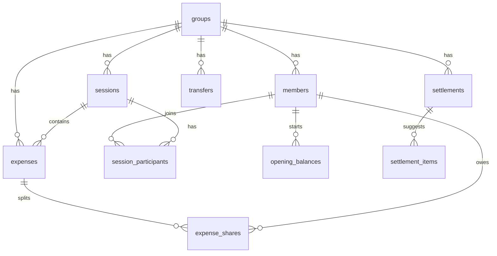

# Đặc tả BA — Web App Chia Tiền Cầu Lông ("Lighter Badminton")

> Tài liệu dành cho **AI Developer**. Hãy đọc hết trước khi code. Mục §12 là các câu hỏi còn mở; nếu chưa có câu trả lời thì dùng giá trị **mặc định** ghi tại đó.

---

## 1. Bối cảnh & mục tiêu

### 1.1 Hiện trạng (As-Is)
Nhóm đang dùng file Google Sheet / Excel `[Lighter] Costing Badminton.xlsx`. Mỗi **đợt chốt sổ** là một sheet riêng (sheet đặt tên `ddmm`: `254`, `274`, `25`, …, `2609`, `1010` — tổng 20 sheet). Một đợt thường gồm 1–3 buổi đánh cầu, đôi khi có thêm sự kiện khác (đi ăn, "Tốt nghiệp Diệp", …).

Cấu trúc một sheet (bản mới, ví dụ `1010`):

| Khu vực | Nội dung |
|---|---|
| Hàng 8 | Danh sách "thành viên" theo cột (Toàn, Trường + Thủy, Băng + Tâm, Tú, Kiên, Tạ Ánh, Quán…) |
| Hàng 9 `Tổng ứng trước` | `SUMIF` cột "Ứng bởi" → tổng tiền mỗi người đã trả hộ |
| Hàng 10 `Tổng chi phí` | `SUM` phần chia của từng người |
| Hàng 11 `Bù trừ nợ đợt trước` | Lấy dư nợ đợt trước bằng `XLOOKUP` sang sheet cũ + các khoản nợ riêng 2 người (ví dụ "Kiên, Toàn \| Cơm trưa") |
| Hàng 12 `Tổng tiền thanh toán` | = Ứng trước − Chi phí − Bù trừ |
| Hàng 14 `K/q` | "Chuyển tiền" (nếu < 0) / "Nhận tiền" (nếu > 0) |
| Hàng 16 `Tình trạng thanh toán` | Nhập tay số tiền mọi người đã chuyển cho **thủ quỹ (Toàn)** |
| Hàng 18–19 `Dư nợ` / `Status` | Phần còn lại; "Done" nếu nằm trong khoảng −3.000 … +1.000 (hoặc +2.000) |
| Từ hàng 24 | Bảng chi tiết: `Tổng tiền \| Ứng bởi \| Ghi chú \| Check \| Danh mục \| <1 cột cho mỗi người> \| Số người` |

Quy tắc chia tiền quan sát được:
1. **Chia theo suất (weighted)**: `= Tổng / Số suất`; các cặp đôi ("Trường + Thủy", "Băng + Tâm", "Thảo + Ny") nhân `*2`.
2. **Tiền cầu tính theo quả**: `=340000/12*N` (ống 12 quả giá 340k, buổi đó dùng N quả) rồi chia theo suất.
3. **Chia cho một nhóm nhỏ**: ví dụ nước chỉ chia cho 2–5 người, ăn uống chia cho 6/8 người, trong khi cặp đôi có khi chỉ tính 1 suất.
4. **Số tiền cụ thể (exact)**: ví dụ bún bò 43k/người, bánh mỳ 25k/người.
5. **Nợ riêng giữa 2 người**: ví dụ "Kiên, Toàn | Mỳ gà tần" −65.000 / +65.000.
6. **Chuyển số dư sang đợt sau**: đầu đợt mới lấy dòng "Dư nợ" của sheet trước qua `XLOOKUP`.
7. **Thanh toán qua thủ quỹ**: ai "Chuyển tiền" thì chuyển hết cho Toàn, sau đó Toàn trả lại cho người "Nhận tiền".

### 1.2 Vấn đề (Pain points) — đã kiểm chứng trên file
| # | Vấn đề | Bằng chứng trong file |
|---|---|---|
| P1 | **Vùng SUM nhập tay dễ sai → lệch tiền** | Sheet `1010`: dòng 31 "Revice + đá" 60.000đ (Kiên ứng) **không nằm trong** `H10 = sum(H26:H30)` → tổng dư nợ toàn nhóm lệch +60.000đ. Ô "Check" vẫn báo TRUE nên không ai phát hiện. |
| P2 | Công thức "vá" bằng tay | `0108!J16 = -J12+25000`; `C10 = 8`, `R26 = COUNTIF(...)+2` (hard-code thêm 2 người vì là cặp đôi) |
| P3 | Mỗi đợt phải copy sheet, sửa cột thành viên, sửa `XLOOKUP` sang sheet trước | Sheet cũ dùng hàng 7/17, sheet mới dùng hàng 8/18 → layout không đồng nhất |
| P4 | Chỉ 1 người nhập được; các thành viên khác không tự ghi khoản mình đã ứng hay đã chuyển tiền | Hàng 16 nhập tay |
| P5 | Ai cũng phải chuyển qua thủ quỹ → nhiều giao dịch hơn mức cần | Cơ chế ở G6 |
| P6 | Số lẻ (`14166.6667`), làm tròn mỗi chỗ một kiểu, "Done" phải dùng khoảng dung sai | Hàng 19 |
| P7 | Thông tin ngân hàng/QR nằm ngoài sheet | — |

### 1.3 Mục tiêu (To-Be)
- Mọi thành viên **đăng nhập**, **tự thêm** khoản mình đã ứng, **tự xác nhận** đã chuyển tiền; người nhận xác nhận đã nhận được.
- Ghi một buổi cầu chỉ mất **dưới 60 giây** trên điện thoại.
- Hệ thống **luôn cân** (tổng số dư của cả nhóm = 0), không còn sai vùng công thức.
- Tự tính **ai chuyển cho ai, bao nhiêu**, có 2 chế độ: *qua thủ quỹ* và *tối thiểu số lần chuyển*. Mỗi giao dịch hiện **ảnh QR** của người nhận (do chính họ upload).
- Nút **copy tin nhắn tổng kết** để dán vào Zalo/Messenger.
- **Import** số dư hiện tại + toàn bộ lịch sử từ file Excel.

---

## 2. Thay đổi nghiệp vụ cốt lõi (quan trọng nhất)

> **Bỏ khái niệm "sheet theo đợt + kết chuyển số dư". Thay bằng một sổ cái (ledger) liên tục.**

Số dư của mỗi người được **tính lại từ toàn bộ giao dịch** (không lưu cứng):

```
balance(m) = opening_balance(m)
           + Σ expenses.amount        (m là người trả)
           − Σ expense_shares.amount  (phần của m)
           + Σ transfers.amount       (m chuyển đi, đã xác nhận)
           − Σ transfers.amount       (m nhận về, đã xác nhận)
```

- `balance > 0` → **Được nhận lại**; `balance < 0` → **Cần chuyển** (giữ đúng quy ước dấu của sheet, hàng 18 "Dư nợ (>0: nhận lại)").
- **Bất biến**: `Σ balance(m) = 0` với mọi m. Viết test cho điều kiện này.
- "Chốt sổ" (settlement) chỉ là **ảnh chụp số dư + danh sách chuyển khoản gợi ý** tại một thời điểm, không phải ranh giới dữ liệu. Không cần `XLOOKUP`/kết chuyển nữa.
- "Bù trừ nợ riêng 2 người" (ví dụ Toàn trả cơm hộ Kiên) = **một khoản chi bình thường** với `paid_by = Toàn` và chia kiểu `exact`: Kiên 35.000. Không cần loại dữ liệu riêng.

---

## 3. Vai trò & quyền

| Vai trò | Quyền |
|---|---|
| **Admin** (thủ quỹ — Toàn, có thể có nhiều admin) | Toàn quyền: quản lý thành viên, sửa/xoá mọi khoản, khoá buổi, tạo chốt sổ, xác nhận hộ giao dịch, import, cài đặt |
| **Member** (đã đăng nhập, đã liên kết với 1 hồ sơ thành viên) | Xem toàn bộ dữ liệu nhóm; tạo buổi; tạo khoản chi **mình trả** (`paid_by = mình`); sửa/xoá khoản **mình tạo** khi buổi chưa khoá; tạo giao dịch chuyển tiền **từ mình**; xác nhận giao dịch **gửi đến mình**; sửa hồ sơ của mình (thông tin ngân hàng, ảnh QR) |
| **Thành viên chưa có tài khoản / khách** (ví dụ "Quán", "Ngân", "Tạ Ánh") | Không đăng nhập; vẫn có thể là người tham gia hoặc người trả tiền. Admin thao tác thay. |

Liên kết tài khoản ↔ thành viên: Admin tạo **link mời** riêng cho từng thành viên (token dùng 1 lần, hết hạn sau 7 ngày). Người được mời đăng nhập rồi mở link → tài khoản được gắn với hồ sơ thành viên đó.

**Cặp đôi**: mặc định là **1 hồ sơ thành viên với `default_weight = 2`** (ví dụ "Trường + Thủy"), giống hệt sheet. Một tài khoản đăng nhập gắn với hồ sơ đó (xem §12, Q3).

---

## 4. Yêu cầu chức năng

### F1. Xác thực
- Supabase Auth: **Google OAuth** + **Email magic link**.
- Lần đăng nhập đầu tiên mà chưa liên kết thành viên → hiện màn hình "Bạn chưa được mời, hãy xin link mời từ admin".

### F2. Thành viên & hồ sơ
- Các trường: tên hiển thị, `default_weight` (1/2), màu avatar, trạng thái (đang hoạt động/đã nghỉ), vai trò.
- **Thông tin nhận tiền**: tên ngân hàng, số tài khoản, tên chủ tài khoản, **ảnh QR (upload)**.
  - Upload: chỉ nhận JPG/PNG/WebP, ≤ 3MB; nén phía client về ảnh rộng ≤ 1000px; lưu vào Supabase Storage bucket `payment-qr` (private, đọc qua signed URL cho thành viên trong nhóm).
  - Mỗi người chỉ sửa được QR của mình; admin sửa được của tất cả (để up hộ thành viên không đăng nhập).
- Không được xoá cứng thành viên đã có giao dịch, chỉ được chuyển sang "đã nghỉ". Thành viên đã nghỉ mà số dư khác 0 vẫn hiện trong phần chốt sổ.

### F3. Buổi (Session)
- Các trường: ngày, loại (`badminton` | `event`), tên/địa điểm (tuỳ chọn), ghi chú, trạng thái (`open` | `locked`).
- **Người tham gia**: danh sách thành viên + `weight` riêng cho buổi đó (mặc định lấy `default_weight`, sửa được, ví dụ "Thảo" có buổi đi cùng Ny → 2).
- Khoá buổi (admin) → không ai sửa được khoản chi trong buổi nữa (admin mở khoá được, có ghi log).

### F4. ⭐ Tạo nhanh buổi cầu (màn hình quan trọng nhất)
Wizard 1 trang, tối ưu cho điện thoại:
1. **Ngày** (mặc định hôm nay).
2. **Ai đi?** — lưới chip thành viên đang hoạt động, bấm để chọn; chip của cặp đôi hiện "×2" và có nút −/+ để sửa weight. Nút "**Giống buổi trước**" chọn lại người của buổi gần nhất.
3. **Tiền sân**: số tiền + ai trả (mặc định là người đang đăng nhập).
4. **Tiền cầu**: số quả dùng (stepper) + ai trả. Giá/quả = `tube_price / shuttles_per_tube` lấy từ Cài đặt (mặc định 340.000 / 12). Có thể ghi đè giá ống.
5. **Khoản khác** (tuỳ chọn, thêm nhiều dòng): tên, số tiền, ai trả, chia cho ai (mặc định: tất cả người tham gia).
6. **Xem trước**: bảng mỗi người phải trả bao nhiêu → **Lưu**.

Lưu = tạo 1 `session` + N `session_participants` + các `expenses` + `expense_shares` trong **một transaction** (dùng RPC Postgres).

### F5. Khoản chi (Expense)
- Các trường: tiêu đề, danh mục (`court`, `shuttle`, `drink`, `food`, `transport`, `gift`, `personal`, `other`), số tiền (số nguyên VND > 0), người trả, buổi (có thể để trống), ghi chú, ảnh hoá đơn (tuỳ chọn).
- **Cách chia** (`split_method`):
  - `weighted` — chia đều theo suất cho các người được chọn (mặc định là người tham gia buổi, weight mặc định lấy theo buổi, sửa được từng dòng).
  - `exact` — nhập số tiền cho từng người; **tổng phải đúng bằng** số tiền khoản chi (nếu chưa khớp thì hiện số còn thiếu/thừa và chặn nút Lưu).
  - `shuttle` — nhập số quả; `amount = round(qty × tube_price / shuttles_per_tube)`; sau đó chia như `weighted`.
- Phần chia được **tính khi lưu và lưu cứng** vào `expense_shares` (để lịch sử không đổi nếu sau này đổi thuật toán). Sửa khoản chi thì tính lại.
- Xoá = **xoá mềm** (`deleted_at`) + ghi audit log.

### F6. Tổng quan số dư (Dashboard)
- Thẻ lớn: "**Bạn cần chuyển 108.167đ**" / "**Bạn được nhận 216.333đ**" / "**Bạn không còn nợ ai** ✓" (khi |số dư| < `done_tolerance`).
- Danh sách số dư của mọi người (sắp xếp theo giá trị), tô màu đỏ = cần chuyển, xanh = được nhận (giữ thói quen màu của sheet).
- Hoạt động gần đây (khoản chi/giao dịch mới).
- Các nút nổi: **+ Buổi cầu**, **+ Khoản chi**, **Thanh toán**.
- Bấm vào 1 người → trang **sổ chi tiết** của người đó: mọi dòng ảnh hưởng đến số dư, có cột số dư luỹ kế (thay cho việc dò lại sheet).

### F7. Chi tiết buổi
- Bảng giống sheet: hàng = khoản chi, cột = người tham gia, ô = phần chia; có dòng tổng mỗi người. Trên mobile hiển thị dạng thẻ theo từng người.

### F8. ⭐ Thanh toán / Ai chuyển cho ai
- Chọn chế độ:
  - **Tối thiểu số giao dịch** (mặc định): thuật toán greedy ở §6.3.
  - **Qua thủ quỹ**: người âm chuyển cho thủ quỹ; thủ quỹ chuyển cho người dương (đúng cách nhóm đang làm).
- Mỗi giao dịch gợi ý hiện: `A → B: 108.167đ` + **ảnh QR của B** (bấm để phóng to/tải về), tên ngân hàng, số tài khoản kèm nút **Copy**, nút copy số tiền, nội dung chuyển khoản gợi ý: `CL <ngay chot> <ten A>`.
  - Nếu B chưa upload QR → hiện "B chưa có QR" + thông tin ngân hàng dạng chữ (nếu có).
- Nút **"Tôi đã chuyển"** (chỉ hiện cho A hoặc admin) → tạo `transfer` trạng thái `pending`.
- B (hoặc admin) nhận được mục trong hộp "**Chờ xác nhận**" → bấm **Đã nhận** (`confirmed`) hoặc **Chưa nhận được** (`rejected`, bắt buộc ghi lý do).
- Chỉ giao dịch `confirmed` mới làm thay đổi số dư. Giao dịch `pending` hiện ở dạng "đang chờ" trên dashboard.
- Cho phép tạo giao dịch thủ công (số tiền tuỳ ý, chuyển một phần).
- Ảnh chụp màn hình chuyển khoản (tuỳ chọn) khi bấm "Tôi đã chuyển".

### F9. Chốt sổ (Settlement snapshot)
- Admin bấm "**Chốt sổ**" → lưu snapshot: thời điểm, số dư từng người, chế độ, danh sách giao dịch gợi ý; tuỳ chọn **khoá tất cả buổi đang mở**.
- Danh sách các lần chốt sổ, mỗi lần có tiến độ "3/5 giao dịch đã xác nhận".

### F10. Copy tin nhắn tổng kết
Nút "Copy tin nhắn" ở trang Buổi và trang Thanh toán, tạo văn bản thuần (có emoji, không dùng markdown vì Zalo không hiển thị):
```
🏸 Tổng kết cầu lông 10/10 (8 suất)
• Sân: 240.000đ (Toàn trả)
• Cầu 3 quả: 85.000đ (Trường + Thủy trả)
Mỗi suất: 40.625đ

💸 Thanh toán:
• Tú → Kiên: 8.571đ
• Quán → Kiên: 40.625đ
...
👉 Xem chi tiết & QR: https://<app>/settle/<id>
```

### F11. Import từ Excel (admin, chạy 1 lần)
Xem §8.

### F12. Nhật ký thay đổi (Audit log)
Mọi thao tác tạo/sửa/xoá khoản chi, giao dịch, buổi, thành viên → ghi `audit_logs` (ai làm, lúc nào, dữ liệu trước/sau dạng JSON). Có trang xem log (admin xem tất cả; member xem log liên quan đến mình).

### F13. Cài đặt nhóm
`tube_price` (340000), `shuttles_per_tube` (12), `done_tolerance` (1000), `transfer_rounding` (1 = không làm tròn; tuỳ chọn 1000), `treasurer_member_id`, `default_settle_mode`.

---

## 5. Yêu cầu phi chức năng
- **Mobile-first** (hầu hết thao tác trên điện thoại), responsive đến desktop. Có PWA (manifest + icon) để thêm vào màn hình chính.
- UI **tiếng Việt**; code, tên bảng, biến bằng **tiếng Anh**.
- Tiền: **số nguyên VND** (`bigint`), **không dùng float** ở bất cứ đâu. Hiển thị `216.333đ` (`Intl.NumberFormat('vi-VN')`).
- Múi giờ `Asia/Ho_Chi_Minh`; ngày hiển thị `dd/MM/yyyy`.
- Bảo mật: bật **RLS trên mọi bảng**; mọi phép ghi nhiều bảng phải đi qua RPC `security definer` có kiểm tra quyền.
- Hiệu năng: dashboard tải < 2 giây trên mạng 4G với khoảng 5.000 khoản chi.
- Giao diện hiện đại: dark mode mặc định, màu nhấn xanh lá kiểu sân cầu, có micro-animation khi số dư thay đổi.

---

## 6. Quy tắc tính toán (Calculation engine)

> Viết thành **thư viện TypeScript thuần** (`/lib/engine`), không phụ thuộc DB, test bằng Vitest. Phía server dùng lại đúng các hàm này.

### 6.1 Chia theo suất — phương pháp phần dư lớn nhất (Largest Remainder)
```
input: amount (int), participants [{member_id, weight (int ≥1), sort_order}]
W = Σ weight
for each p: raw = amount * p.weight / W
            base = floor(raw); frac = raw - base
R = amount - Σ base                     // số đồng còn dư, 0 ≤ R < số người
Cộng thêm 1đ cho R người có frac lớn nhất; nếu bằng nhau thì ưu tiên sort_order tăng dần.
=> Σ share = amount (chính xác tuyệt đối)
```
Dùng phép tính số nguyên (`amount * weight` rồi chia lấy nguyên và lấy dư) để tránh sai số float.

### 6.2 Tiền cầu
`amount = round_half_up(qty * tube_price / shuttles_per_tube)` → chia theo §6.1.

### 6.3 Tối thiểu số giao dịch (greedy)
```
creditors = members có balance ≥ done_tolerance  (sắp xếp giảm dần)
debtors   = members có balance ≤ -done_tolerance (sắp xếp theo |balance| giảm dần)
while cả hai danh sách còn phần tử:
    x = min(|debtor.balance|, creditor.balance)
    tạo transfer debtor → creditor : x (làm tròn theo transfer_rounding)
    trừ x khỏi cả hai bên; loại bên nào đã về |balance| < done_tolerance
```
Bảo đảm ≤ (n − 1) giao dịch. Kết quả phải ổn định (cùng input → cùng output; khi bằng nhau thì tie-break theo `sort_order`).

### 6.4 Qua thủ quỹ
Mọi debtor (trừ thủ quỹ) → thủ quỹ: |balance|. Thủ quỹ → mọi creditor (trừ thủ quỹ): balance.

### 6.5 Trạng thái "Đã xong"
`|balance| < done_tolerance` (mặc định 1.000đ) → hiện "Đã xong ✓" (thay cho khoảng −3000…+1000 của sheet).

---

## 7. Mô hình dữ liệu (Supabase / Postgres)



| Bảng | Cột chính |
|---|---|
| `groups` | `id uuid pk`, `name`, `tube_price int default 340000`, `shuttles_per_tube int default 12`, `done_tolerance int default 1000`, `transfer_rounding int default 1`, `treasurer_member_id`, `default_settle_mode text`, `created_at` |
| `members` | `id`, `group_id`, `display_name`, `default_weight smallint default 1 check (1..4)`, `user_id uuid null unique → auth.users`, `role text check in ('admin','member') default 'member'`, `is_active bool`, `sort_order int`, `avatar_color`, `bank_name`, `bank_account_no`, `bank_account_holder`, `qr_image_path`, `created_at` |
| `member_invites` | `id`, `member_id`, `token text unique`, `expires_at`, `used_at`, `created_by` |
| `sessions` | `id`, `group_id`, `date date`, `type text check in ('badminton','event')`, `title`, `note`, `status text check in ('open','locked')`, `created_by → members`, `created_at`, `deleted_at` |
| `session_participants` | `session_id`, `member_id`, `weight smallint` — PK (`session_id`,`member_id`) |
| `expenses` | `id`, `group_id`, `session_id null`, `title`, `category`, `amount bigint check > 0`, `paid_by → members`, `split_method text check in ('weighted','exact','shuttle')`, `shuttle_qty int null`, `tube_price_snapshot int null`, `note`, `receipt_path`, `created_by`, `created_at`, `updated_at`, `deleted_at` |
| `expense_shares` | `expense_id`, `member_id`, `weight smallint null`, `amount bigint check ≥ 0` — PK (`expense_id`,`member_id`). Constraint (trigger deferred hoặc kiểm tra trong RPC): `Σ amount = expenses.amount` |
| `transfers` | `id`, `group_id`, `from_member`, `to_member`, `amount bigint > 0`, `status text check in ('pending','confirmed','rejected')`, `note`, `proof_path`, `settlement_id null`, `created_by`, `created_at`, `confirmed_by`, `confirmed_at`, `reject_reason` ; check `from_member <> to_member` |
| `opening_balances` | `member_id pk`, `group_id`, `amount bigint` (có thể âm), `source text` (ví dụ `'excel:1010'`), `created_at` |
| `settlements` | `id`, `group_id`, `mode`, `treasurer_member_id`, `balances jsonb`, `created_by`, `created_at`, `note` |
| `settlement_items` | `id`, `settlement_id`, `from_member`, `to_member`, `amount`, `transfer_id null` |
| `audit_logs` | `id`, `group_id`, `actor_member_id`, `action`, `entity`, `entity_id`, `before jsonb`, `after jsonb`, `created_at` |
| `legacy_sheets` | `id`, `sheet_name`, `period_date date`, `raw jsonb` (dữ liệu đã parse), `imported_at` — **chỉ đọc**, không ảnh hưởng số dư |

**View** `member_balances` (`member_id`, `paid`, `owed`, `sent`, `received`, `opening`, `balance`) tính theo công thức §2 (chỉ lấy dòng `deleted_at is null` và transfer `confirmed`).

**RPC** (security definer, kiểm tra quyền bên trong):
- `create_session_with_expenses(payload jsonb)`
- `upsert_expense(payload jsonb)` — tính lại shares bằng logic giống engine. **Khuyến nghị**: client tính shares bằng engine TS, server **kiểm tra lại** (Σ = amount, member nằm trong nhóm, quyền).
- `confirm_transfer(id)`, `reject_transfer(id, reason)`
- `create_settlement(mode, lock_sessions bool)`
- `accept_invite(token)`

**RLS (tóm tắt)**:
- SELECT: user là member của `group_id`.
- INSERT `expenses`: `paid_by = my_member_id` HOẶC user là admin.
- UPDATE/DELETE `expenses`: (`created_by = me` VÀ session chưa locked) HOẶC admin.
- INSERT `transfers`: `from_member = me` HOẶC admin. UPDATE status: `to_member = me` HOẶC admin.
- UPDATE `members` (bank/QR): `user_id = auth.uid()` HOẶC admin.
- Storage `payment-qr/{member_id}/*`: ghi nếu là chủ hoặc admin; đọc nếu cùng nhóm.

---

## 8. Import dữ liệu Excel

Dùng script Node (`/scripts/import-excel.ts`, thư viện `xlsx`/SheetJS, đọc **giá trị đã tính** chứ không đọc công thức). Phải có chế độ `--dry-run` để in báo cáo trước khi ghi DB.

### 8.1 Bước A — Thành viên
Gom tất cả tên xuất hiện ở hàng header của 20 sheet → bảng mapping để admin xác nhận (ví dụ `Trường + Thủy` → weight 2; các sheet cũ `254` có `Trường`, `Thủy` riêng lẻ → map vào cùng hồ sơ hoặc tạo hồ sơ cũ đã nghỉ). Xuất `members-mapping.json` để người dùng chỉnh tay rồi mới chạy tiếp.

### 8.2 Bước B — Số dư mở đầu (ảnh hưởng số dư thật)
Lấy hàng **"Dư nợ (>0: nhận lại)"** của sheet mới nhất `1010` → `opening_balances`. Giá trị gốc trong file:

| Toàn | Trường + Thủy | Băng + Tâm | Tú | Kiên | Tạ Ánh | Quán | **Tổng** |
|---|---|---|---|---|---|---|---|
| −154.591 | 0 | 0 | 0 | 255.216 | 0 | −40.625 | **+60.000 ⚠️** |

> [!WARNING]
> Tổng phải bằng 0 nhưng đang lệch **+60.000đ** do lỗi P1. Script phải **từ chối import** nếu `|Σ opening| ≥ done_tolerance`, trừ khi có cờ `--force` hoặc file sửa tay. Phương án đã sửa (đưa dòng 31 vào tổng chi phí) — xem §12, Q1:
>
> | Toàn | Trường + Thủy | Băng + Tâm | Tú | Kiên | Tạ Ánh | Quán | Tổng |
> |---|---|---|---|---|---|---|---|
> | −163.163 | −17.144 | −17.142 | −8.571 | 246.645 | 0 | −40.625 | **0** |
>
> (Đã tính lại bằng engine §6.1, giữ nguyên các dòng bù trừ và khoản đã chuyển của sheet; tổng đúng bằng 0.)

### 8.3 Bước C — Kho lưu trữ lịch sử (chỉ để xem, không ảnh hưởng số dư)
Với mỗi sheet (trừ `Note`):
- Tìm **hàng thành viên**: hàng có ô chứa `Thành viên`, hoặc hàng ngay trên `Tổng chi`/`Tổng ứng trước` (bản cũ: hàng 4 hoặc 7; bản mới: hàng 8). Đọc tên từ cột H trở đi đến ô trống.
- Tìm **bảng chi tiết**: hàng có `Tổng tiền`/`Total` ở cột C. Đọc từng dòng: C = số tiền, D = người trả, E = ghi chú, G = danh mục; các cột thành viên = phần chia. Dòng chỉ có G mà C trống (ví dụ "Đánh cầu ngày 10/10") = **tiêu đề buổi**.
- Phần **"Bù trừ nợ đợt trước"**: lưu lại, đánh dấu dòng nào là kết chuyển ("xem sheet trc") và dòng nào là nợ riêng.
- Đọc thêm hàng "Tình trạng thanh toán" và "Dư nợ".
- Ngày của đợt: tên sheet `ddmm` (`25` = 2/5, `105` = 10/5, `254` = 25/4) + năm (§12, Q2).
- Lưu vào `legacy_sheets.raw`. Trang "**Lịch sử cũ**" hiển thị lại dạng bảng giống sheet.
- **Kiểm tra chéo**: với mỗi sheet, so Σ(dư nợ) với 0 và in cảnh báo cho sheet bị lệch (sẽ bắt được lỗi ở `1010`).

> Không import lịch sử thành expense thật, vì công thức trong sheet đã vá tay ở nhiều chỗ (P2), sẽ không khớp lại được. Số dư thật chỉ lấy từ Bước B.

---

## 9. Màn hình (Sitemap)

| Route | Màn hình | Ai |
|---|---|---|
| `/login` | Đăng nhập Google / magic link | all |
| `/invite/[token]` | Nhận lời mời, liên kết hồ sơ | all |
| `/` | Dashboard số dư (F6) | member |
| `/sessions` | Danh sách buổi (lọc theo tháng) | member |
| `/sessions/new` | ⭐ Tạo nhanh buổi (F4) | member |
| `/sessions/[id]` | Chi tiết buổi (F7) + copy tin nhắn | member |
| `/expenses/new`, `/expenses/[id]` | Thêm/sửa khoản chi (F5) | member |
| `/settle` | ⭐ Ai chuyển cho ai + QR + "Tôi đã chuyển" (F8) | member |
| `/settle/history`, `/settle/[id]` | Các lần chốt sổ (F9) | member |
| `/inbox` | Giao dịch chờ tôi xác nhận | member |
| `/members/[id]` | Sổ chi tiết của 1 người | member |
| `/profile` | Hồ sơ tôi: ngân hàng + upload QR | member |
| `/admin/members` | Quản lý thành viên, tạo link mời, up QR hộ | admin |
| `/admin/settings` | Cài đặt (F13) | admin |
| `/admin/audit` | Nhật ký | admin |
| `/legacy` | Lịch sử từ Excel | member |

Bottom nav trên mobile: **Tổng quan · Buổi · (+) · Thanh toán · Tôi**.

---

## 10. Tech stack & cấu trúc thư mục

- **Next.js (App Router) + TypeScript** (khởi tạo bằng `npx -y create-next-app@latest ./`, chạy `--help` trước để xem tuỳ chọn).
- **Supabase**: Postgres, Auth, Storage; `@supabase/ssr`. Migration SQL nằm trong `/supabase/migrations`.
- **CSS**: Vanilla CSS / CSS Modules + design tokens trong `globals.css` (không dùng Tailwind). Font: *Be Vietnam Pro* (hiển thị dấu tiếng Việt tốt).
- Validation: **Zod**. Ngày: **date-fns** (+ `date-fns-tz`).
- Test: **Vitest** (engine), **Playwright** (luồng E2E chính).
- Deploy: **Vercel** + Supabase free tier. Biến môi trường: `NEXT_PUBLIC_SUPABASE_URL`, `NEXT_PUBLIC_SUPABASE_ANON_KEY`, `SUPABASE_SERVICE_ROLE_KEY` (chỉ dùng cho script import).

```
/app            routes (xem §9)
/components     UI dùng chung (MoneyText, MemberChip, WeightStepper, QrCard, BalanceCard…)
/lib/engine     split.ts, shuttle.ts, balances.ts, settle.ts, format.ts  (+ *.test.ts)
/lib/supabase   client/server helpers, types sinh bằng `supabase gen types`
/supabase/migrations
/scripts/import-excel.ts
```

---

## 11. Lộ trình & tiêu chí nghiệm thu

| Phase | Nội dung | Done khi |
|---|---|---|
| **0. Setup** | Khởi tạo Next.js, Supabase, design tokens, layout + bottom nav | Deploy được trang trống lên Vercel |
| **1. Engine** | `/lib/engine` + toàn bộ test §11.1 | `vitest` xanh 100% |
| **2. Schema + Auth** | Migration, RLS, RPC, login, invite, hồ sơ + upload QR | User thường không sửa được khoản của người khác (có test RLS) |
| **3. Buổi & Khoản chi** | F3, F4, F5, F7 | Tạo buổi 8 người, 3 khoản chi trong < 60 giây trên mobile |
| **4. Số dư & Thanh toán** | F6, F8, F9, F10, inbox | Luồng: gợi ý → "Tôi đã chuyển" → người nhận xác nhận → số dư về 0 |
| **5. Import** | §8 A/B/C | Dry-run in được báo cáo, phát hiện lệch ở `1010`; import xong dashboard hiện đúng bảng ở §8.2 |
| **6. Hoàn thiện** | Audit log, PWA, empty/loading/error states, dark mode polish | Lighthouse mobile ≥ 90 (Performance/Accessibility) |

### 11.1 Test case vàng (lấy từ dữ liệu thật)

**TC1 — sheet `274` (3 người, weight 1, Toàn trả hết)**
Sân 136.500, nước 45.000, xiên nướng 143.000; người tham gia (theo sort_order): Toàn, Tú, Kiên.
- Phần chia xiên: 47.667 / 47.667 / 47.666 (dư 2đ cho 2 người đầu theo tie-break).
- Số dư kỳ vọng: **Toàn +216.333, Tú −108.167, Kiên −108.166**; tổng = 0. (Sheet ra 216.333 / −108.167 / −108.167, chênh 1đ do làm tròn — chấp nhận được.)

**TC2 — sheet `1209`, buổi 12/09 (cặp đôi weight 2)**
Người tham gia: Toàn 1, Trường + Thủy 2, Băng + Tâm 2, Tú 1, Kiên 1, Thái 1, Thảo 1, Phan 1 → W = 10.
- Sân 345.000 → 34.500/suất; cặp đôi 69.000.
- Cầu 8 quả → `round(8 × 340000/12)` = **226.667** → suất 22.667 hoặc 22.666, cặp đôi 45.333; Σ = 226.667.

**TC3 — chia một nhóm nhỏ, cặp đôi tính 1 suất** (`2609` dòng 28): nước 60.000 chia cho Toàn, Trường + Thủy (weight **1**), Tú, Kiên, Quán → mỗi người 12.000.

**TC4 — exact** (`0808` dòng 37): bún bò 172.000, mỗi người 43.000 cho Toàn, Trường + Thủy, Tú, Quán. Nhập Σ ≠ 172.000 → bị chặn lưu.

**TC5 — nợ riêng**: Toàn trả cơm 35.000 cho Kiên (`exact`, chỉ Kiên) → Toàn +35.000, Kiên −35.000.

**TC6 — tối thiểu giao dịch**: số dư `{A:+300, B:+100, C:−250, D:−150}` (nghìn đồng) → `C→A 250`, `D→A 50`, `D→B 100` (3 giao dịch). Chế độ thủ quỹ với thủ quỹ = A → `C→A 250`, `D→A 150`, `A→B 100`.

**TC7 — bất biến**: sinh ngẫu nhiên 1.000 khoản chi + giao dịch (property test) → luôn có `Σ balance = 0` và mọi `Σ shares = amount`.

**TC8 — transfer**: `pending` không đổi số dư; `confirmed` thì đổi; `rejected` không đổi và bắt buộc có lý do.

---

## 12. Câu hỏi còn mở (dev dùng giá trị mặc định nếu chưa có trả lời)

| # | Câu hỏi | Mặc định |
|---|---|---|
| Q1 | Khoản "Revice + đá" 60k ở sheet `1010` là **lỗi** (cần chia cho 7 suất, dùng bảng đã sửa ở §8.2) hay cố ý không tính? | Coi là lỗi → dùng bảng đã sửa |
| Q2 | Các sheet `254` → `1010` thuộc **năm** nào? | Năm hiện tại trừ 1 nếu ngày rơi vào tương lai; cho phép truyền tham số `--year` |
| Q3 | Cặp đôi dùng **chung 1 tài khoản** (1 hồ sơ weight 2) hay mỗi người 1 tài khoản riêng nhưng gộp ví? | Chung 1 hồ sơ, weight 2 |
| Q4 | Có muốn tự sinh **VietQR động có sẵn số tiền** (dùng `img.vietqr.io` từ số tài khoản) bên cạnh ảnh QR upload? | Chưa làm ở MVP; để sẵn chỗ trên `QrCard` |
| Q5 | Member thường có được **sửa khoản chi của người khác** không? | Không (chỉ admin) |
| Q6 | Có cần nhắc nợ tự động (email/Zalo)? | Ngoài phạm vi MVP |
| Q7 | Làm tròn số tiền chuyển khoản đến 1.000đ? | Không làm tròn (`transfer_rounding = 1`) |
